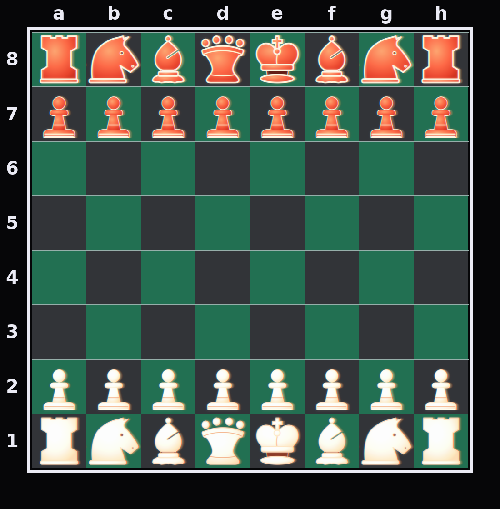
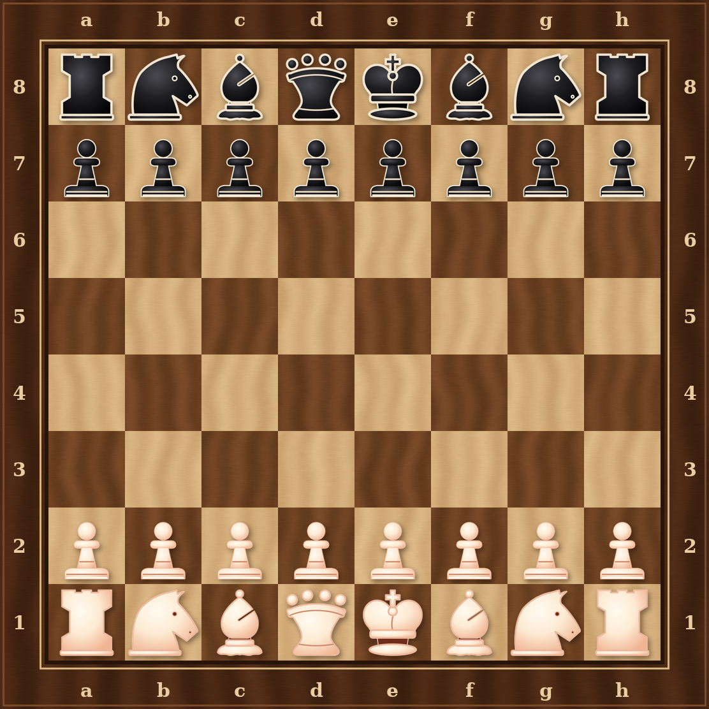

# Retro Chess Pieces

Chess piece sets inspired by the soft, glowing graphics of a 1980s TV chess broadcast.
All pieces are 512×512 transparent PNGs (plus SVG sources).

## Folders

- `clean/` – crisp pieces (best for chess sites)
- `crt/` – pieces with a soft VHS/CRT glow and scanlines
- `svg/` – vector versions
- `previews/` – sample boards
- `source/` – the Python scripts that generate everything

## Public image URLs (clean)

Pattern: `https://cdn.jsdelivr.net/gh/isayoldchap/retro-chess-pieces@main/clean/<colour>_<piece>.png` — swap `clean` for `crt` for the glow versions.

### Ivory (light side) — `white`

| Piece | URL |
|---|---|
| king | https://cdn.jsdelivr.net/gh/isayoldchap/retro-chess-pieces@main/clean/white_king.png |
| queen | https://cdn.jsdelivr.net/gh/isayoldchap/retro-chess-pieces@main/clean/white_queen.png |
| rook | https://cdn.jsdelivr.net/gh/isayoldchap/retro-chess-pieces@main/clean/white_rook.png |
| bishop | https://cdn.jsdelivr.net/gh/isayoldchap/retro-chess-pieces@main/clean/white_bishop.png |
| knight | https://cdn.jsdelivr.net/gh/isayoldchap/retro-chess-pieces@main/clean/white_knight.png |
| pawn | https://cdn.jsdelivr.net/gh/isayoldchap/retro-chess-pieces@main/clean/white_pawn.png |

### Broadcast red (original dark side) — `red`

| Piece | URL |
|---|---|
| king | https://cdn.jsdelivr.net/gh/isayoldchap/retro-chess-pieces@main/clean/red_king.png |
| queen | https://cdn.jsdelivr.net/gh/isayoldchap/retro-chess-pieces@main/clean/red_queen.png |
| rook | https://cdn.jsdelivr.net/gh/isayoldchap/retro-chess-pieces@main/clean/red_rook.png |
| bishop | https://cdn.jsdelivr.net/gh/isayoldchap/retro-chess-pieces@main/clean/red_bishop.png |
| knight | https://cdn.jsdelivr.net/gh/isayoldchap/retro-chess-pieces@main/clean/red_knight.png |
| pawn | https://cdn.jsdelivr.net/gh/isayoldchap/retro-chess-pieces@main/clean/red_pawn.png |

### True black — `black`

| Piece | URL |
|---|---|
| king | https://cdn.jsdelivr.net/gh/isayoldchap/retro-chess-pieces@main/clean/black_king.png |
| queen | https://cdn.jsdelivr.net/gh/isayoldchap/retro-chess-pieces@main/clean/black_queen.png |
| rook | https://cdn.jsdelivr.net/gh/isayoldchap/retro-chess-pieces@main/clean/black_rook.png |
| bishop | https://cdn.jsdelivr.net/gh/isayoldchap/retro-chess-pieces@main/clean/black_bishop.png |
| knight | https://cdn.jsdelivr.net/gh/isayoldchap/retro-chess-pieces@main/clean/black_knight.png |
| pawn | https://cdn.jsdelivr.net/gh/isayoldchap/retro-chess-pieces@main/clean/black_pawn.png |

### Ebony wood (near-black with grain) — `brown`

| Piece | URL |
|---|---|
| king | https://cdn.jsdelivr.net/gh/isayoldchap/retro-chess-pieces@main/clean/brown_king.png |
| queen | https://cdn.jsdelivr.net/gh/isayoldchap/retro-chess-pieces@main/clean/brown_queen.png |
| rook | https://cdn.jsdelivr.net/gh/isayoldchap/retro-chess-pieces@main/clean/brown_rook.png |
| bishop | https://cdn.jsdelivr.net/gh/isayoldchap/retro-chess-pieces@main/clean/brown_bishop.png |
| knight | https://cdn.jsdelivr.net/gh/isayoldchap/retro-chess-pieces@main/clean/brown_knight.png |
| pawn | https://cdn.jsdelivr.net/gh/isayoldchap/retro-chess-pieces@main/clean/brown_pawn.png |

## More previews

